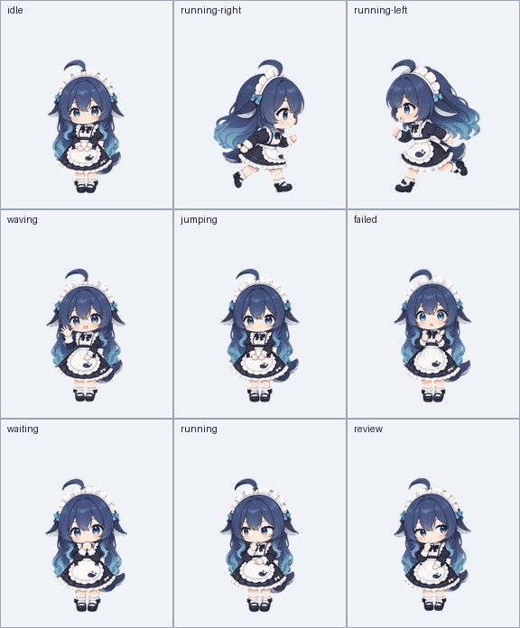
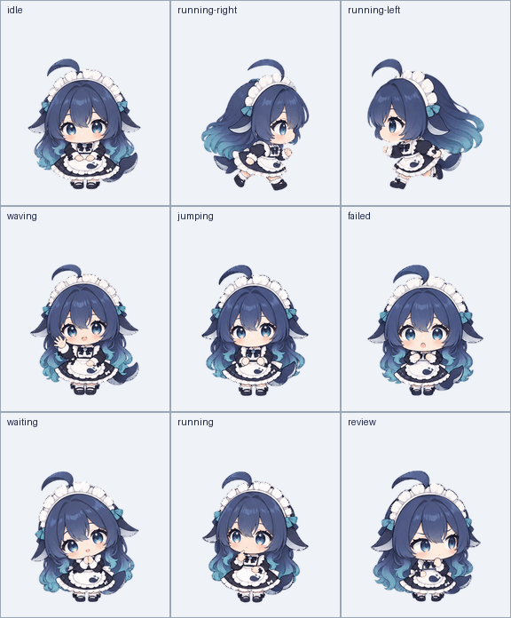

# 小鯨魚娘 · Whale Girl Pet

深藍色長髮、鯨魚尾同側鰭嘅 Q 版女僕小鯨魚。提供 **原版** 同 **A 短身版** 兩個獨立方案，可以按喜好選擇。

## 選擇方案

| | 原版 | A 短身版 |
| --- | --- | --- |
| 正面預覽 |  |  |
| 身體比例 | 保留原有身軀同腿部比例 | 大頭、短身軀、短腿 |
| 素材版本 | v1.0.0 | v1.1.0 |
| 完整素材包 | [下載原版 ZIP](https://github.com/makcheunghei/whale-girl-pet/releases/download/v1.0.0/whale-girl-pet-v1.0.0.zip) | [下載短身版 ZIP](https://github.com/makcheunghei/whale-girl-pet/releases/download/v1.1.0/whale-girl-pet-v1.1.0.zip) |
| 透明動畫圖 | [下載原版 PNG](https://github.com/makcheunghei/whale-girl-pet/releases/download/v1.0.0/whale-girl-v2.png) | [下載短身版 PNG](https://github.com/makcheunghei/whale-girl-pet/releases/download/v1.1.0/whale-girl-v2.png) |
| 動畫影片 | [原版 MP4](https://github.com/makcheunghei/whale-girl-pet/releases/download/v1.0.0/whale-girl-motion.mp4) | [短身版 MP4](https://github.com/makcheunghei/whale-girl-pet/releases/download/v1.1.0/whale-girl-motion.mp4) |
| 說明與逐狀態預覽 | [原版完整說明](variants/original/README.md) | [短身版完整說明](variants/short/README.md) |
| Release | [原版發佈頁面](https://github.com/makcheunghei/whale-girl-pet/releases/tag/v1.0.0) | [短身版發佈頁面](https://github.com/makcheunghei/whale-girl-pet/releases/tag/v1.1.0) |

兩款均包含九種狀態動畫、16 個望向周圍嘅方向姿勢、透明動畫圖、GIF／MP4 預覽及驗證資料。

## 原版動畫

[全部姿勢](variants/original/previews/contact-sheet.png) · [16 個方向](variants/original/previews/directions.png) · [待機與跳躍](variants/original/previews/idle-jump.gif)

## A 短身版動畫

[選定比例參考](variants/short/assets/character-reference.png) · [全部姿勢](variants/short/previews/contact-sheet.png) · [16 個方向](variants/short/previews/directions.png) · [待機與跳躍](variants/short/previews/idle-jump.gif)

## 倉庫內嘅兩套素材

- **原版**：[variants/original](variants/original/README.md)，內有 `assets/`、`previews/`、`pet.json` 同 `validation.json`。
- **A 短身版**：[variants/short](variants/short/README.md)，內有同一套檔案結構及選定比例參考。

下載倉庫後，直接使用所選方案嘅目錄即可。根目錄現有嘅 `assets/`、`previews/`、`pet.json` 同 `validation.json` 保留 v1.1.0 短身版路徑相容性；選擇方案時請使用上面兩個明確目錄。

## 共用動畫圖格式

| 項目 | 兩款共用規格 |
| --- | --- |
| 格式 | PNG，透明背景，sprite sheet v2 |
| 整張尺寸 | 1536 × 2288 px |
| 每格尺寸 | 192 × 208 px |
| 排列 | 8 欄 × 11 列 |
| 有效姿勢／留空透明格 | 73／15 |
| 標準狀態 | 待機、向右移動、向左移動、揮手、跳躍、失敗、等待輸入、思考／處理工作、檢查 |
| 方向姿勢 | 16 個方向，每格順時針增加 22.5° |

方向使用畫面座標：**000° 向上、090° 向右、180° 向下、270° 向左**。每列格數及播放方式詳見各方案嘅 README 同 `pet.json`。GIF／MP4 係動畫示範，實際播放節奏由使用素材嘅程式決定。

## 驗證摘要

| 項目 | 原版 | A 短身版 |
| --- | --- | --- |
| 尺寸、透明背景及格位 | 73 格通過 | 73 格通過 |
| 跳躍最高離地 | 36 px | 14 px |
| 落地與待機位置差 | 1 px | 0 px |
| 驗證資料及 PNG SHA-256 | [原版 validation.json](variants/original/validation.json) | [短身版 validation.json](variants/short/validation.json) |

兩款嘅四個主方向、全身完整度及比例均已接受視覺審查。部分相鄰斜角嘅轉頭幅度較細，保留原有審查提示。

素材由 AI 輔助生成，再作逐格提取、排列、比例對齊及驗證。兩套現有 Release 素材包均獨立保留。
